# Manual Keyboard-Only Accessibility Assessment

- **Auditor:** Salma Meziane (Role: Accessibility and Evidence)
- **Application:** Spring PetClinic Angular (http://localhost:4200/petclinic)
- **Evaluation Baseline:** WCAG 2.2 Level AA
- **Evaluation Method:** Strict keyboard-only navigation without mouse or pointer interaction (Tab, Shift+Tab, Enter, Space, Arrow keys, Escape)
- **Scope Audited:** Core Business Lifecycle (Owner -> Pet -> Visit), Veterinarian Directory and Specialisms, and Admin Configuration (Pet Types and Specialties).

---

## 1. Summary and Testing Approach
Automated linters like axe-core and Lighthouse are useful for basic syntax and static colour contrast checks, but they routinely miss practical runtime keyboard faults. Issues such as dropped focus on page changes, focus traps, custom widget navigation, and accidental data deletion can only be caught by working through the interface manually.

This audit logs the results of a full, hands-on keyboard walkthrough across each primary user flow in the Angular frontend to ensure the site meets WCAG 2.2 Level AA requirements.

---

## 2. Walkthrough Notes and Screen Evidence

### 2.1 Owner Registration and Input Validation (/petclinic/owners/add)
- **Keyboard Route:** Stepped through inputs using Tab (First Name -> Last Name -> Address -> City -> Telephone -> Back -> Add Owner).
- **Validation Checks (WCAG 3.3.1 Error Identification - Level A):**
  - Pressing Add Owner on an empty form triggered inline error alerts:
    - "First name must consist of letters only"
    - "Last name is required"
    - "Address is required"
    - "City is required"
    - "Phone number only accepts digits" / "Phone number must be exactly 10 digits"
- **Defect Found (DEF-A11Y-01):** Focus remained stuck on the Add Owner button instead of shifting up to the first field with an error (First Name). Keyboard and screen reader users receive no prompt explaining where the error occurred.
- **Valid Entry:** Filled in details for Jane Doe (123 High Street, London, 0123456780). Green checkmarks appeared alongside each field as expected.
- **Evidence Images:**
  - 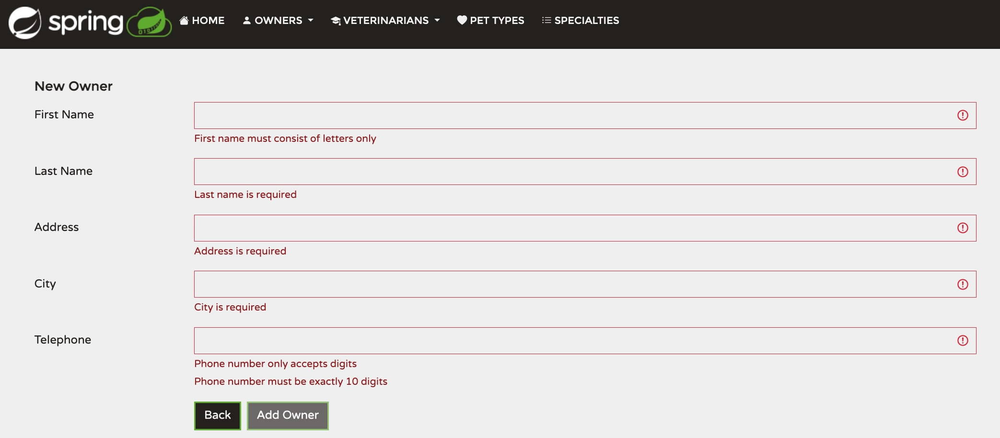
  - 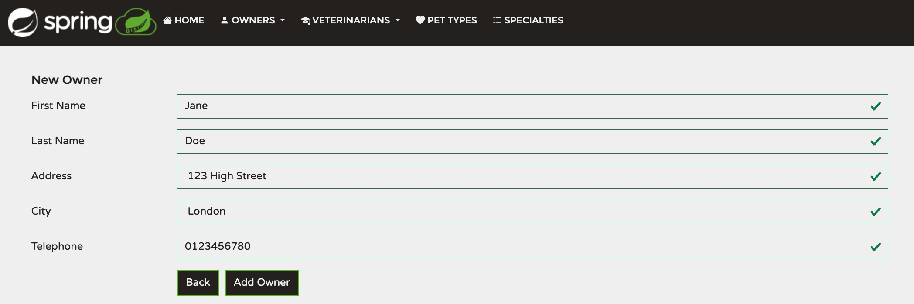

### 2.2 Pet Registration and Native Select Controls (/petclinic/owners/11/pets/add)
- **Keyboard Route:** Navigated from Jane Doe's record to the "Add New Pet" button using Tab and opened it with Enter.
- **Field Navigation:** Tabbed through Name (Milo) and Birth Date (2026/01/13).
- **Dropdown Behaviour (WCAG 2.1.1 Keyboard and 2.1.2 No Keyboard Trap - Level A):**
  - The Pet Type select control responded directly to Up and Down arrow keys.
  - Selected "cat" without issues and exited the control using Tab with no focus locking.
- **Saving:** Moved focus to Save Pet and submitted the form cleanly.
- **Evidence Images:**
  - 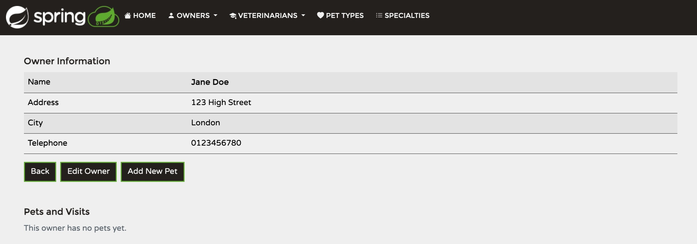
  - 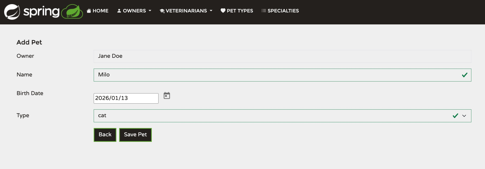

### 2.3 Visit Booking and Lifecycle Check (/petclinic/pets/14/visits/add)
- **Keyboard Route:** On Jane Doe's profile, tabbed down to the Pets and Visits table, highlighted "Add Visit" under Milo, and triggered it with Enter.
- **Data Input:** Entered the visit date (2026-11-11) and added the description "Annual health checkup and rabies booster".
- **Database Persistence:** Submitted the form via keyboard. The visit saved properly to the backend and appeared in Milo's table row with working Edit Visit and Delete Visit buttons.
- **Evidence Image:**
  - 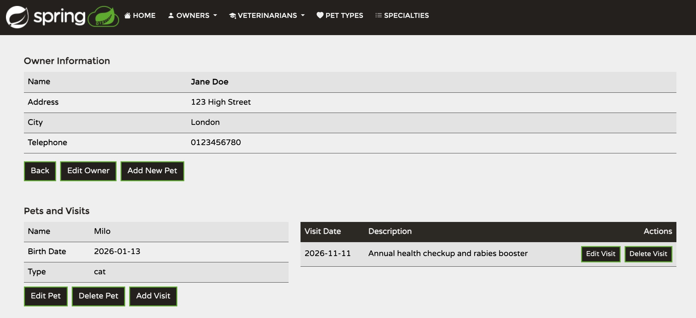

### 2.4 Veterinarians and Custom Dropdown Menus (/petclinic/vets and /edit)
- **Bypass Links (WCAG 2.4.1 Bypass Blocks - Level A):**
  - Walked through the Vets directory. Every vet row has two separate tab stops (Edit Vet and Delete Vet).
  - Defect Found: The page has no "Skip to Content" link at the top, meaning keyboard users have to tab through dozens of table buttons to get to the footer controls.
- **Custom Multi-Select Control (WCAG 2.1.1 Keyboard - Level A):**
  - Checked the specialisms dropdown on Helen Leary's record.
  - The menu expanded with Space, and options (dentistry, radiology, surgery) were toggled using the arrow keys and Space without touching the mouse.
- **Evidence Images:**
  - 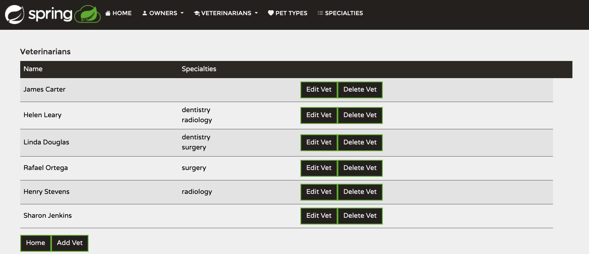
  - 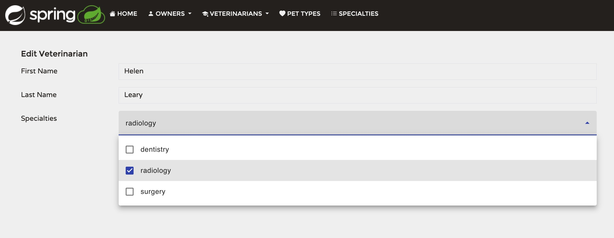
  - 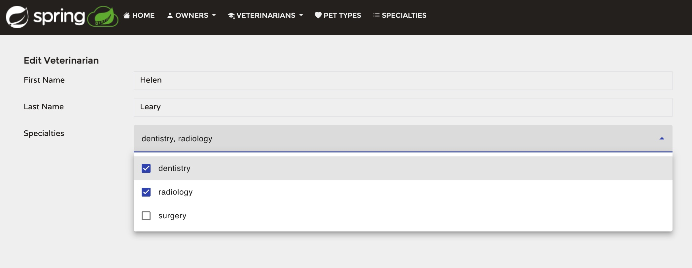

### 2.5 Admin Tables: Pet Types and Specialisms (/petclinic/pettypes and /specialties)
- **Inline Editing (WCAG 2.1.1 Keyboard):**
  - Both tables place editable values directly into text input fields with adjacent Edit and Delete buttons. All elements were reachable using Tab.
- **Accidental Deletion Risk (WCAG 3.3.4 Error Prevention - Level AA):**
  - Pressing Delete on the "bird" entry deleted it immediately from the database.
  - Defect Found: The app shows no confirmation prompt or modal before deleting. One misplaced keystroke removes the record permanently.
- **Evidence Images:**
  - 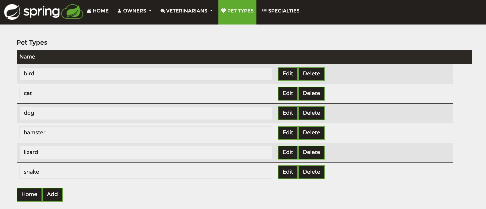
  - 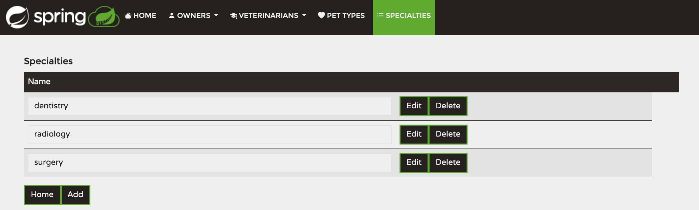

### 2.6 Supplemental Audit Evidence
- **Additional Captures:** Extra verification screens recorded during testing runs.
- **Evidence Images:**
  - 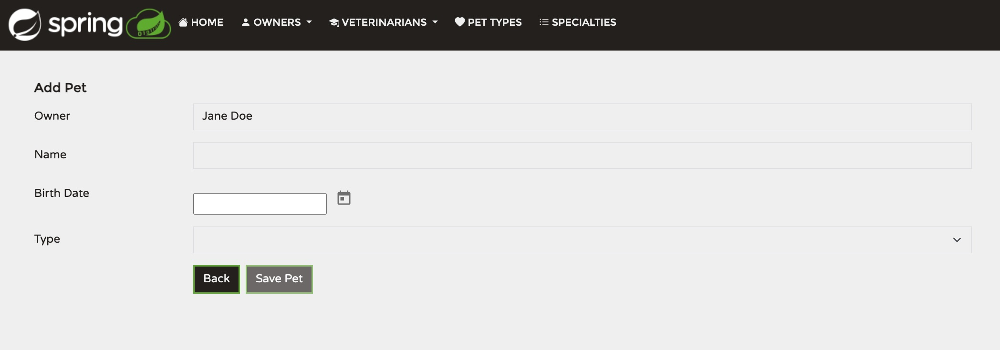
  - 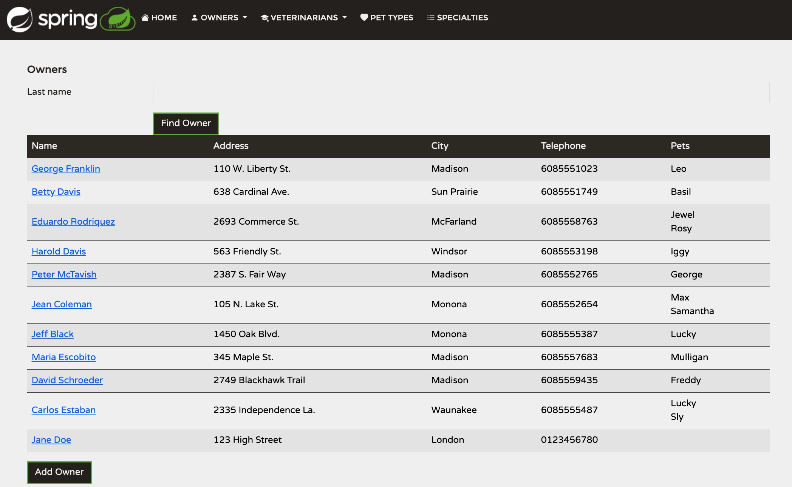

---

## 3. WCAG 2.2 AA Compliance Summary

| Criterion | Level | Requirement | Result | Observation |
| :--- | :---: | :--- | :---: | :--- |
| **2.1.1 Keyboard** | A | All actions work via keyboard. | **PASS** | Inputs, native selects, buttons, and custom dropdowns can all be driven by keyboard. |
| **2.1.2 No Keyboard Trap** | A | Focus can move away from all controls. | **PASS** | Date inputs, selects, and table rows release focus cleanly on Tab. |
| **2.4.1 Bypass Blocks** | A | Ways exist to skip repetitive blocks. | **FAIL** | No skip link exists; users must tab through long tables and nav headers repeatedly. |
| **2.4.3 Focus Order** | A | Tab order follows logical meaning. | **FAIL** | Focus does not shift to invalid fields on failed submit; resets to top on route change. |
| **2.4.7 Focus Visible** | AA | Clear visual indicator on active element. | **FAIL** | Top navigation bar links lack high-contrast focus outlines against the dark background. |
| **3.3.1 Error Identification** | A | Form errors are clearly stated in text. | **PASS** | Clear inline warnings describe the exact problem (e.g. 10 digits required, letters only). |
| **3.3.4 Error Prevention** | AA | Destructive actions can be checked or undone. | **FAIL** | Delete buttons in Pet Types and Specialties delete rows instantly without a confirmation prompt. |
| **4.1.3 Status Messages** | AA | Dynamic updates are announced to assistive tech. | **FAIL** | Page updates and redirects do not use aria-live regions to tell screen readers when tasks finish. |

---

## 4. Accessibility Defect Log

### DEF-A11Y-01: Focus Stays on Submit Button After Validation Failure
- **Severity:** Medium
- **WCAG References:** 2.4.3 Focus Order (Level A), 3.3.1 Error Identification (Level A)
- **Page:** /petclinic/owners/add
- **Problem:** Submitting an empty form shows red validation text, but focus stays resting on the submit button instead of jumping to the first broken field.
- **Fix:** Add an Angular helper directive to send focus straight to the first invalid control when submit is clicked.

### DEF-A11Y-02: Poor Focus Visibility on Main Navigation Bar
- **Severity:** Low
- **WCAG Reference:** 2.4.7 Focus Visible (Level AA)
- **Page:** Global Header (/petclinic/*)
- **Problem:** Focus styling on header links is faint and difficult to distinguish against the dark header colour.
- **Fix:** Add a high-contrast focus ring in styles.css: `a:focus, button:focus { outline: 2px solid #5cb85c; outline-offset: 2px; }`.

### DEF-A11Y-03: Missing Skip to Main Content Link
- **Severity:** Low
- **WCAG Reference:** 2.4.1 Bypass Blocks (Level A)
- **Page:** Global Navigation
- **Problem:** Users must tab through all navigation links and repetitive table rows on every single page view before reaching the main content.
- **Fix:** Place a visually hidden `<a class="skip-link" href="#main-content">Skip to content</a>` link at the very top of the root template.

### DEF-A11Y-04: Permanent Record Deletion Without Confirmation
- **Severity:** Medium
- **WCAG Reference:** 3.3.4 Error Prevention (Data) (Level AA)
- **Page:** /petclinic/pettypes and /petclinic/specialties
- **Problem:** Clicking Delete purges entries instantly without a confirmation prompt or undo feature.
- **Fix:** Connect delete actions to an accessible modal dialog requiring an explicit confirmation keypress before deleting.

---

## 5. Ongoing Quality Policy
- **When to Run:** Manual keyboard walkthroughs must be carried out before every major release candidate and tagged deployment.
- **Pull Request Trigger:** Any pull request modifying shared form components, navigation templates, table designs, or global style sheets.
- **Why It Matters:** Automated test tools only inspect markup; physical keyboard verification is the only reliable way to check dynamic focus order, dialog behaviour, and data safety.
